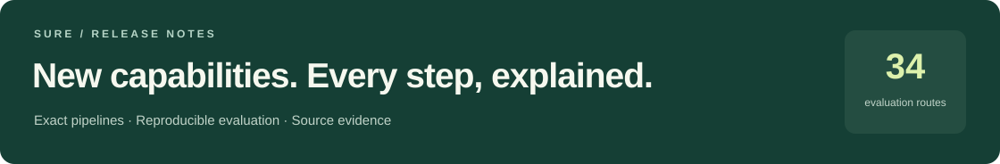

# Release notes

<!-- generated by news-agent; do not edit inside this block -->



New evaluation capabilities, their exact pipelines, and the source behind each update.

[Visual release notes](index.html) · [Latest updates](latest.md)

<a id="ear-1"></a>

### EAR-1 evaluation support

<kbd>Supported</kbd> &nbsp; 18 Nov 2026

Evaluate EAR-1 SD/DER and Mandarin SA-ASR/cpCER submissions. Submission conversion and the required text normalization feed the organizer scorer, which writes report.json.

| Task | Metric | Evaluation path |
| :--- | :--- | :--- |
| **SD** | **DER** | Submission conversion → EAR-1 scorer → `report.json` |
| **SA-ASR / zh** | **cpCER** | Submission conversion → EAR-1 normalization → EAR-1 scorer → `report.json` |

<details>
<summary>Exact pipeline IDs &amp; versioned nodes</summary>

**SD / DER**

```text
sd.any.der.conversion_sd_ear1_submission_v1.ear1_scorer_v1
```

`conversion/sd__ear1_submission` (v1) → `scoring/ear1_scorer` (v1) → `report.json`

**SA-ASR / cpCER**

```text
sa_asr.zh.cpcer.conversion_sa_asr_ear1_submission_v1.ear1_norm_v1.ear1_scorer_v1
```

`conversion/sa_asr__ear1_submission` (v1) → `normalization/ear1_norm` (v1) → `scoring/ear1_scorer` (v1) → `report.json`

</details>

> **Before you run**
>
> Uses v1 nodes and the openbench-integration-0.1 scorer. Install SciPy and provide sessions.json with track D1 or R1. DER uses collar 0 and pools sessions; character-level cpCER is not comparable with cpWER.

[Full announcement](../../docs/news/index.md#ear-1) · Task docs: [sa_asr](../../docs/tasks/sa_asr.md) · [sd](../../docs/tasks/sd.md) · [Catalog](../../docs/pipeline_catalog.jsonl) · [Source change](https://github.com/PigeonDan1/sure-evaluation/commit/3853dab1db5d7d44691b25a6620932742a1c0a50)

<details>
<summary>Source &amp; validation</summary>

Local validation on 2026-11-18 against 3853dab1db5d7d44691b25a6620932742a1c0a50: python -m pytest tests/test\_ear1\_routes.py -q; 13 passed. Both SD/DER and SA-ASR/cpCER match the organizer fixture outputs. Copy manually prepared; no model call.

[test_ear1_routes.py](https://github.com/PigeonDan1/sure-evaluation/blob/3853dab1db5d7d44691b25a6620932742a1c0a50/tests/test_ear1_routes.py) · [expected.json](https://github.com/PigeonDan1/sure-evaluation/blob/3853dab1db5d7d44691b25a6620932742a1c0a50/tests/fixtures/ear1/esd/expected.json) · [expected.json](https://github.com/PigeonDan1/sure-evaluation/blob/3853dab1db5d7d44691b25a6620932742a1c0a50/tests/fixtures/ear1/esr/expected.json)

[Source 1](https://github.com/PigeonDan1/sure-evaluation/commit/c1bc96cf865baef07e37f702a8286d3a6c68a5a2)

</details>

